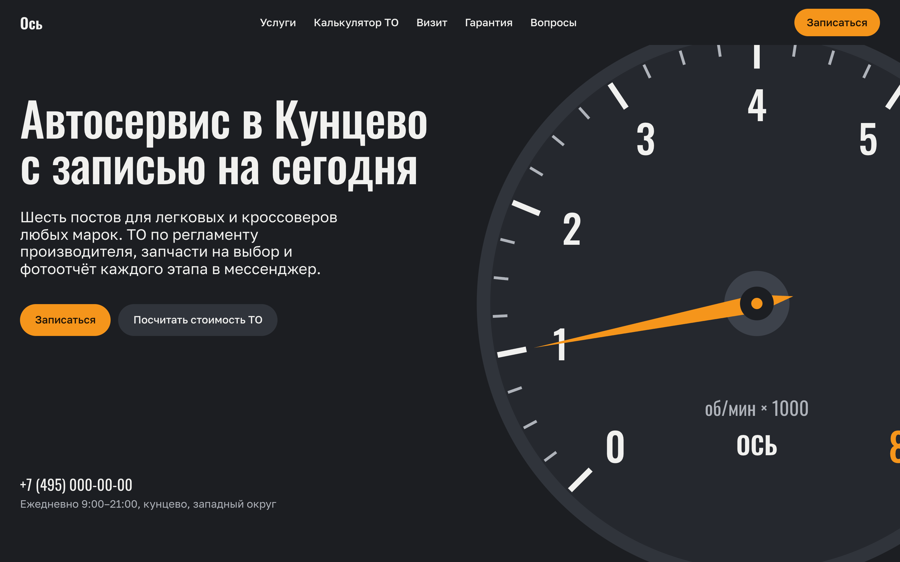
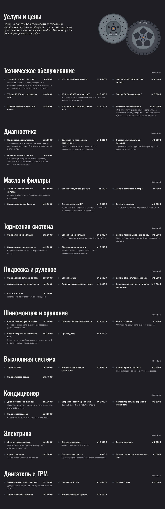
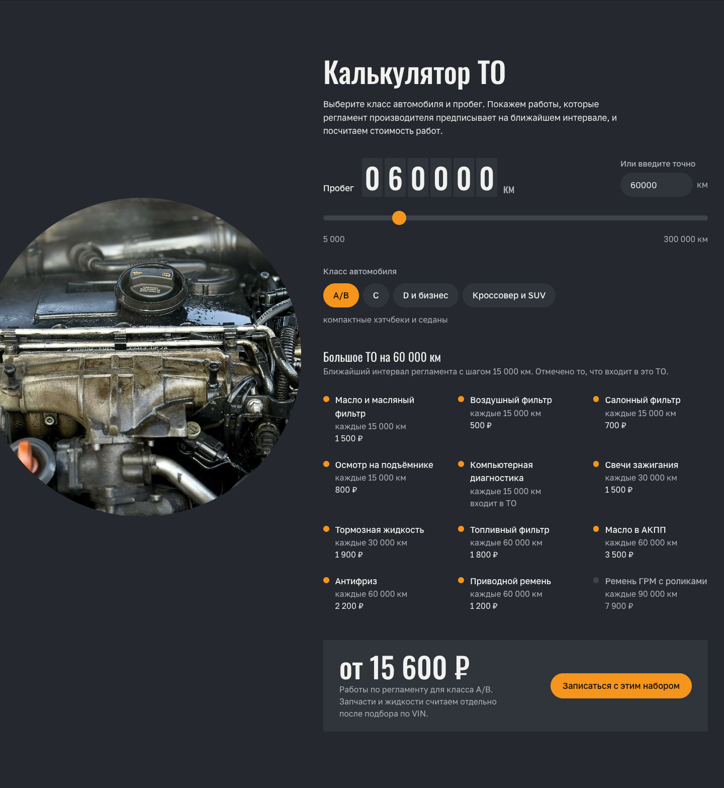
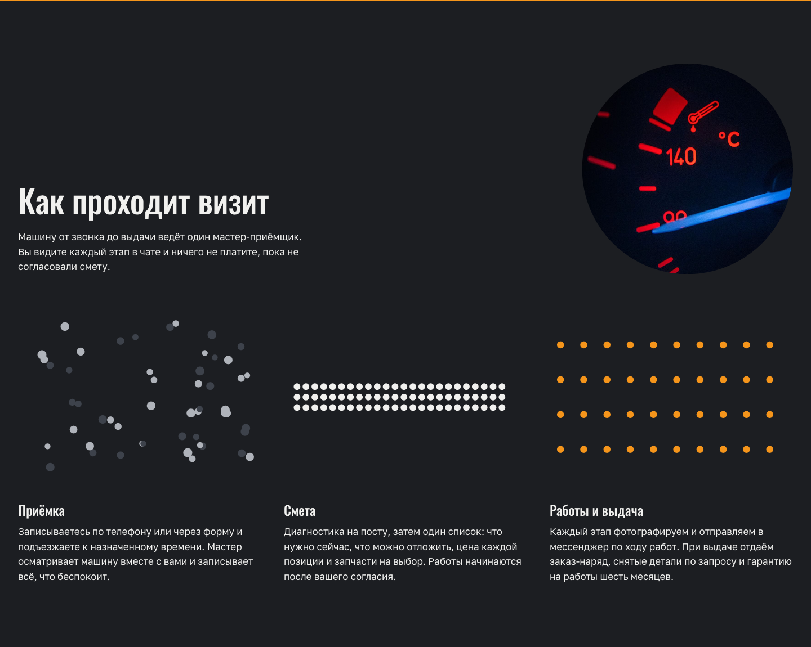
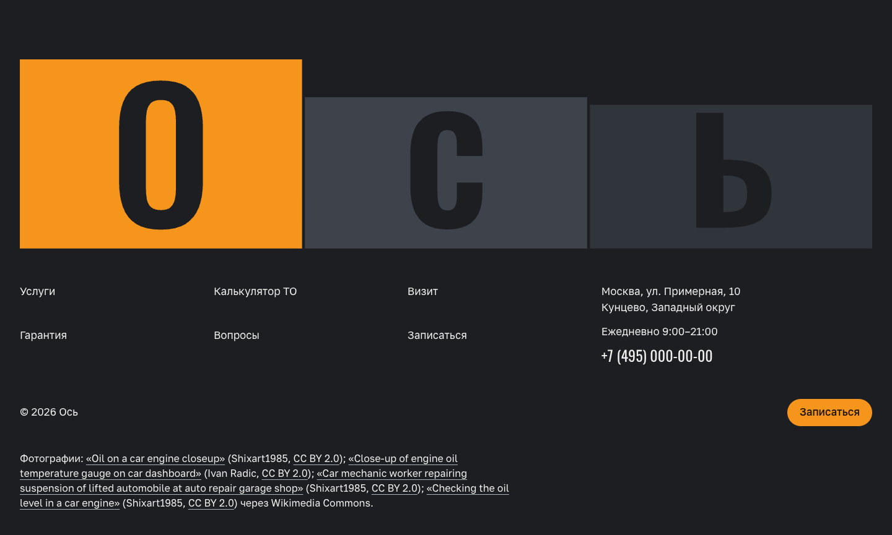

# Ось: сайт автосервиса

Одностраничный сайт автосервиса в Кунцево: шесть постов, ТО по регламенту производителя, калькулятор стоимости ТО и запись на сегодня. Демо для портфолио: компания вымышленная, цены и имена — примеры.

**Демо:** https://malishq.github.io/autoservice-website/

## Что умеет

- Hero с анимированным тахометром: стрелка оживает при загрузке и дальше следует за прокруткой, заголовок собирается из слов (GSAP SplitText).
- Полный прайс: 10 групп и 55 позиций с ценами «от …», цены ТО считаются из той же таблицы регламента, что и калькулятор.
- Калькулятор ТО: класс автомобиля (A/B, C, D и бизнес, кроссовер и SUV) и пробег через одометр, ползунок или точный ввод → список регламентных работ на ближайшем интервале с ценами и итог. Кнопка «Записаться с этим набором» прокручивает к форме и подставляет набор в комментарий. Работает с клавиатуры и на телефоне; без JavaScript показывает регламент целиком.
- Схема шести постов, диаграмма «как проходит визит», условия гарантии и выбора запчастей, вопросы-ответы в виде карточек-закладок.
- Форма записи в виде купона: выбор услуги, проверка полей, экран успеха. Работает без сервера, при желании отправляет JSON на свой адрес.
- Плавный скролл Lenis, GSAP-ревилы по секциям, параллакс фотографий, учёт `prefers-reduced-motion`.
- Своя композиция для телефона и планшета, статическая сборка для любого хостинга.

## Стек

Next.js 16 (статический экспорт), React 19, Tailwind CSS 4, GSAP 3.15 (ScrollTrigger, SplitText), Lenis. Шрифты Oswald и Golos Text через `next/font/google` с кириллицей. Рисунки (тахометр, тормозной диск, колесо, ключ, план постов, диаграмма) — инлайн-SVG в палитре сайта.

## Скриншоты











## Запуск

```bash
npm ci
npm run dev
```

Сборка: `npm run build` (папка `out/`). Выкладка на GitHub Pages: `scripts/deploy.sh`.

## Форма заявки

Форма работает без сервера: по умолчанию показывает экран успеха. Чтобы заявки приходили на почту или в Telegram, укажите адрес приёма в переменной `NEXT_PUBLIC_FORM_ENDPOINT` (POST JSON с полями `name`, `phone`, `service`, `comment`).

## Как адаптировать под клиента

- Название, телефон, адрес, часы и пункты меню: `src/lib/site.ts`.
- Прайс: `src/lib/services.ts` (группы и позиции, цены в рублях). Позиции ТО считаются автоматически из регламента.
- Регламент и калькулятор: `src/lib/maintenance.ts` (классы с коэффициентами, работы с интервалами и базовыми ценами, шаг 15 000 км).
- Вопросы и ответы: `src/lib/faq.ts`. Тексты секций: `src/components/*.tsx`.
- Фотографии и подписи к ним: `src/lib/photos.ts`, файлы в `public/images/`.
- Цвета и размеры шрифтов: `src/app/globals.css`; гарнитуры: `src/app/layout.tsx`.

Все цены, адрес и телефон — примерные данные, их нужно заменить на реальные.

## Источники фотографий

Фотографии с Wikimedia Commons, лицензия CC BY 2.0, авторы указаны в подвале сайта:

- «Oil on a car engine closeup», Shixart1985 — https://commons.wikimedia.org/wiki/File:Oil_on_a_car_engine_closeup.jpg
- «Close-up of engine oil temperature gauge on car dashboard», Ivan Radic — https://commons.wikimedia.org/wiki/File:Close-up_of_engine_oil_temperature_gauge_on_car_dashboard_(49006320293).jpg
- «Car mechanic worker repairing suspension of lifted automobile at auto repair garage shop», Shixart1985 — https://commons.wikimedia.org/w/index.php?curid=194512646
- «Checking the oil level in a car engine», Shixart1985 — https://commons.wikimedia.org/wiki/File:Checking_the_oil_level_in_a_car_engine.jpg

Остальные изображения нарисованы кодом (SVG).
